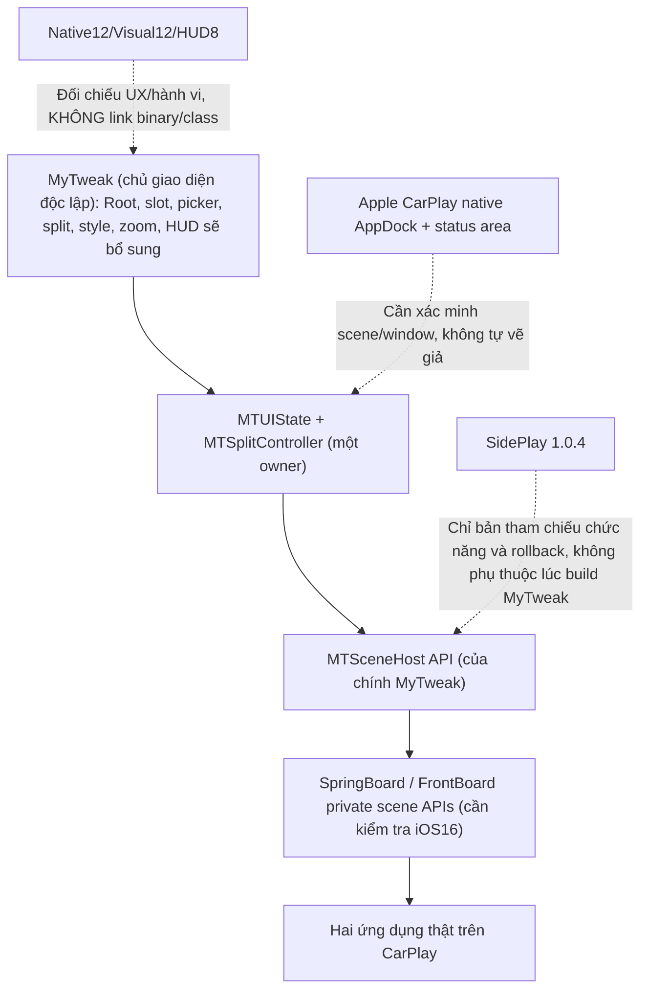
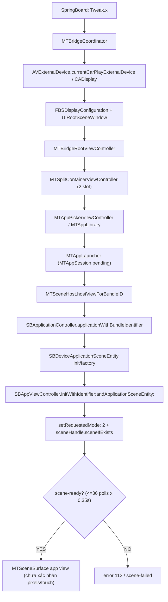

# MyTweak có thể thay SidePlay làm host CarPlay cho DuoFace không?

## Quyết định kiến trúc mới: MyTweak sở hữu UI lẫn host (2026-10-19)

**Nguồn yêu cầu mới:** Người dùng chỉ ra sơ đồ “Native12 core → SceneHost adapter → SidePlay” vẫn dễ dẫn tới nối trực tiếp các class đóng `CB*` chứa license. Đề xuất đảo chiều: **MyTweak là root UI/window/split/picker do chính dự án sở hữu và phát triển độc lập `MTSceneHost` v1a→v1c; Native12/Visual12/HUD8 chỉ là chuẩn UX/hành vi, tuyệt đối không là binary/runtime dependency.** Đây là thay đổi kiến trúc được ưu tiên **để thử nghiệm có cổng kiểm chứng**, thay vì tiếp tục QA overlay SidePlay. Giữ các gói hiện đang phát hành để rollback, không tự cắt SidePlay hoặc sửa giấy phép.

### Kiểm chứng lại mã gốc được user gửi, không nhầm bản stub

- Nguồn: `MyTweak_Independent_SceneHost_trial_source_20261018.txt` (Project Library), SHA256 raw UTF-8 `ea561904b62717f617706ba453e004f037feef4a3c6cdab2c00327f0dac50e16`; 25 file, 1.552 dòng tổng nguồn.
- Đã trích đủ 25 file thành thư mục thử tạm (không tính lưu bền vững) và chạy `python /mnt/data/mytweak_decision/extracted/mytweak/tests/test_scenehost_contract.py` → **6/6 PASS, 0.006 giây**, chỉ static source, **KHÔNG iOS build/CarPlay test**.
- **UI thực có:** `MTBridgeRootViewController`, `MTSplitContainerViewController` với 2 slot + 8pt divider, pan ratio 25–75%, fullscreen double-tap; `MTAppPickerViewController` bảng app; `MTAppSlotViewController` với thanh tiêu đề 44pt và nút chọn app; `MTAppLauncher` gọi `MTSceneHost`. UI là **alpha riêng của MyTweak, chưa đạt hình/kích thước/hành vi Native12**.
- **HUD chưa có trong nguồn này:** không có `MTHUD`, `SpeedHUD` hoặc module tốc độ trong 25 file/Makefile; câu “HUD đã có sẵn” có thể áp dụng phiên bản MyTweak khác mà chưa có chứng cứ. Cần bổ sung module do MyTweak sở hữu khi source mới được kiểm chứng.
- **Chưa có bản mã v1b/v1c trong nguồn này:** việc gọi tên `MTSceneHost v1a→v1c` là các **mốc phát triển đề xuất**, không được ghi như đã chạy.
- **Host thử nghiệm thật đã có:** `MTBridgeCoordinator` dùng `AVExternalDevice.currentCarPlayExternalDevice` + `CADisplay.uniqueId`, `FBSDisplayConfiguration`, `UIRootSceneWindow`. `MTSceneHost.m` 332 dòng tạo `SBDeviceApplicationSceneEntity`, `SBAppViewController`, `setRequestedMode:2`; poll scene handle 36 lần mỗi 0,35s, update scene resize, stop/invalidate và cleanup. Không import/link bất cứ class `CBBridgeManager`, `CBWindow`, `SPDash`, `SPPane` hoặc package vendor.
- **Chưa chứng minh scene hiển thị:** `host-created` chỉ tạo view pending, `scene-ready` chỉ chứng minh `sceneHandle.sceneIfExists` không nil. Mã `layoutScene` dùng hệ số logical 2x/host transform 0,5x **giả định** từ nguồn tham khảo, chưa nghiệm thu pixels/touch. `MTBridgeRootViewController.view` và split view nền **đen opaque toàn màn hình**, dù `UIRootSceneWindow.opaque=NO`; không có `AppDockVC` → nguy cơ che Dock thật và không thể tuyên bố đã khắc phục Dock.
- **Vấn đề ký hiệu private API:** thực tế `SBDeviceApplicationSceneEntity` thử `initWithApplicationForMainDisplay:`/ `newEntityWithApplicationForMainDisplay:` nhưng chưa có runtime introspection iOS16.7.x; dùng MainDisplay entity khi trình bày trên CarPlay external display là giả thuyết cần xác minh. SpringBoard crashes/scene teardown vẫn có thể xảy ra. Không có quyền giả định các private selector tương thích chỉ nhờ source test.

### So sánh kiến trúc được chọn

| Tiêu chí | SidePlay host + UI MyTweak/Native12 reimplementation | MyTweak hoàn toàn làm chủ UI + host |
|---|---|---|
| App đang chạy trên CarPlay | Đã được user kiểm nghiệm từ SidePlay, ít rủi ro host | **Chưa chứng minh** scene render/touch/audio |
| Đồng sở hữu UI, menu, frame | Nguy cơ còn `SPDash.layout:/SPPane.layoutInFrame:` | **Không còn phụ thuộc class vendor**; một split/UI owner |
| Giấy phép bên thứ ba | Phụ thuộc SidePlay hợp lệ nếu vẫn giữ host | **Không có code/license vendor trong nguồn**, không cần nối watchdog Native12 |
| Dock Apple thật | Vẫn chưa chạy trong QA sideplay | **Cũng chưa được giải**; source có opaque root che Dock |
| Phù hợp mục tiêu độc lập lâu dài | Trung bình; khó loại hoàn toàn SidePlay | **Ưu tiên nghiên cứu dài hạn**, nhưng cần POC host |
| Thời gian có chức năng xem app ngay | SidePlay hiện dễ hơn | MyTweak có rủi ro private API và kiểm thử cao hơn |

**Kết luận:** Đồng ý **MyTweak là root sản phẩm ưu tiên cho kiến trúc độc lập**, nhưng chỉ chuyển sang thay SidePlay/Native12 runtime sau khi PoC chứng minh được App scene thật. Không được nhầm ưu thế kiến trúc với host đã hoạt động hoặc dễ hoàn thành nhanh hơn.

### Sơ đồ mới

### Giai đoạn kỹ thuật GO/NO-GO

1. **v1a diagnostic:** ghi rõ chính xác các class/selector SpringBoard hiện có trên máy, CarPlay `CADisplay`, trạng thái window/UIScene/AppDock, thử launch **một** app, bảo đảm không crash. Không ghép Native12.
2. **v1b app-host proof:** xác nhận **pixels app thật**, touch/scroll, audio, foreground, orientation và close/restore trong một slot. `scene-ready` chỉ log, không phải GO.
3. **v1c dual-host + native Dock:** hai app đồng thời, drag ratio, fullscreen, detach/reconnect/respring không SpringBoard crash/exitmode, Apple AppDock hiển thị đủ icons và trạng thái hệ thống Normal. **No native Dock = NO-GO**, chỉnh owner/z-order/insets thực tế, không đặt 64pt giả.
4. **Sau v1c PASS:** nâng UI MyTweak theo bản đặc tả hành vi Native12 (chứ không chép các lớp đóng), thêm HUD8 độc lập; xóa hoàn toàn thử nghiệm ghép SidePlay/QA khỏi **gói MyTweak**, giữ QA11 trên Sileo làm rollback cho tới khi bản độc lập nghiệm thu.
5. Không đóng gói, cài đồng thời hoặc tự nâng version Sileo **khi chưa được yêu cầu triển khai**. Giữ mọi bản ổn định.

**GOAL/Owner được thay đổi:** hướng trước ưu tiên SidePlay host-only là **fallback để sử dụng hiện tại**, không còn là mục tiêu dài hạn duy nhất. MyTweak độc lập được ưu tiên làm ứng viên kiến trúc lâu dài, điều kiện quyết định là v1a→v1c có thiết bị xác minh. Chưa có runtime/source edits/build/deploy mới trong lượt đánh giá.

Kiểm tra 2026-10-19. **KẾT LUẬN: khả thi để thử như host ĐỘC LẬP, CHƯA CÓ bằng chứng hoạt động trên CarPlay thật, chưa được chọn làm host thay SidePlay.** Không can thiệp giấy phép Native12 hoặc SidePlay.

## Nguồn đã kiểm chứng

Người dùng đã gửi MyTweak trước đó. Tìm được trong Project Library nguồn `MyTweak_Independent_SceneHost_trial_source_20261018.txt` (tạo 2026-10-18, 61.897 bytes trên Library; sau materialize local UTF-8 60.452 ký tự), sha256 của **file UTF-8 materialized**: `ea561904b62717f617706ba453e004f037feef4a3c6cdab2c00327f0dac50e16`. File chứa 25 mục mã/header/Makefile/plist/tests; **không lưu lại toàn bộ code người dùng trên GitHub trong cuộc audit này**, chỉ ghi kết quả và đường dẫn tài liệu.

- Bản gốc `MyTweak 0.2.0` ở đầu README vẫn nói `MTSceneHost` “stub”, `code:1001`; nhưng phần `Experimental independent scene-host trial (2026-10-18)` và **mã `MTSceneHost.m` 333 dòng cuối file** đã thay stub bằng thử nghiệm private API của SpringBoard. Không được đánh giá nhầm hai phiên bản.
- Chạy đúng `python /mnt/data/mytweak_audit/mytweak/tests/test_scenehost_contract.py`: **6/6 unittest PASS**, 0.007 giây, **chỉ structural/static**. Không có bằng chứng build Theos/DEB, không có log SpringBoard/CarPlay của MyTweak trên thiết bị.
- GitHub `chuongnguyen89dn-ui/Duoface` search `MTSceneHost` không tìm thấy source MyTweak đã commit vào default branch; đây là **nguồn người dùng gửi trong Library**, không mặc định là nhánh QA11 hay M1 host-only đang chạy.
- Đối chiếu tài liệu header cộng đồng `theos/headers/SpringBoard/SBAppViewController.h`: có `initWithIdentifier:andApplicationSceneEntity:`, `setRequestedMode:`, `invalidate`; chỉ xác nhận API từng tồn tại, **không xác minh đúng iOS16.7.x và class/selector in situ**. Header khác khai báo `SBDeviceApplicationSceneEntity` factory khác nhau tùy bản hệ điều hành.

## Sơ đồ luồng MyTweak thử nghiệm (mã đã đọc, chưa chứng minh runtime)

## Đánh giá từng lớp

| Lớp/khả năng | Mã MyTweak thực có | Xác minh được | Thiếu trước khi coi là host thực |
|---|---|---|---|
| SpringBoard inject | `Tweak.x` hook `applicationDidFinishLaunching:`, `MyTweak.plist` filter SpringBoard, Theos rootless | Byte/source có | Device boot/respring không crash |
| CarPlay display | `MTBridgeCoordinator` tra `AVExternalDevice` screenIDs + `CADisplay.uniqueId` | Có kiểm CarPlay display chứ không chọn bừa màn thứ hai | APIs thực tồn tại và trả về đúng CADisplay trên máy |
| CarPlay window | `FBSDisplayConfiguration.initWithCADisplay:isMainDisplay:`; `UIRootSceneWindow.initWithDisplayConfiguration:` | Có mã tạo window riêng SpringBoard | iOS có render đúng scene? Native Apple Dock có bị phủ bởi root full-screen UI? |
| App host | `MTSceneHost` tra `SBApplicationController`, tạo `SBDeviceApplicationSceneEntity` và `SBAppViewController` | Có mã tạo controller, attach child view, yêu cầu mode 2 | Hai class/selector tồn tại iOS16.7.x, class factory đúng thực tế và scene có mở được app |
| Scene ready | Poll `sceneHandle.sceneIfExists`, tối đa 36 x .35 s; log `scene-ready` | Biết scene handle tồn tại | **KHÔNG** chứng minh pixels, touch, audio, display focus/rotation |
| Resize/split | 2x logical pixel, 0.5 scale, resize scene settings/foreground, 2 panes 25–75% | Có code thực | **2x/0.5x chỉ giả định**; hở gesture/keyboard/orientation/retina; không phải UI Native12 |
| Cleanup | setRequestedMode:0, invalidate, stopAllHosts, restore settings | Có mã rollback và log | Kiểm SpringBoard crash/exitmode, app/background/reconnect/trùng scene |
| AppDock Apple | **Không có `appDockVC` hoặc hợp đồng CarPlay icon/status Dock** | Chưa có owner cho Dock | Native12 Dock chưa được MyTweak giải quyết |
| Giấy phép | Không gọi `CBBridgeManager`, `CBLicenseSyncManager`, không depends SidePlay | Có chứng cứ source **độc lập** | Private SpringBoard APIs và quyền thực thi vẫn có thể bị giới hạn iOS, jailbreak hoặc scene policy; không đồng nghĩa hoạt động chắc chắn |

## Rào cản chính xác / khả năng bất tương thích

1. **P0: No runtime evidence.** `host-created` chỉ là tạo pending UIView; `scene-ready` chỉ là handle tồn tại. Không hề có ảnh/video/log thiết bị xác minh thật app iPhone hiển thị trên CarPlay, cảm ứng, audio, two concurrent scenes, disconnect. Không được báo “host đã hoạt động”.
2. **P0: Private API signatures trên iOS16.** `SBDeviceApplicationSceneEntity` trong code thử nghiệm preflight `initWithApplicationForMainDisplay:` hoặc `newEntityWithApplicationForMainDisplay:`, nhưng header tham chiếu khác dùng `defaultEntityWithApplicationForMainDisplay:`. Nếu cả hai selector thử nghiệm không tồn tại trên thiết bị, trả `MTSceneHost error 104` trước khi có host. Không giả định chắc chắn đã hỏng; cần runtime introspection của đúng máy. `SBAppViewController` init cũng cần đối chiếu signature/type.
3. **P0: Display/CarPlay scene ownership.** `initWithApplicationForMainDisplay:` gắn nhãn MainDisplay, trong khi `UIRootSceneWindow` dùng CarPlay `CADisplay`: **không bảo đảm** iOS cho app view hoạt động/touch trên màn CarPlay, hoặc app Dock của Apple được giữ lại. MyTweak `MTBridgeRootViewController.view` nền đen toàn màn, rất có nguy cơ che Dock như QA SidePlay.
4. **P1: UI không phải Native12.** MyTweak có root picker và fixed dual slots riêng (8pt divider, 25–75%, fullscreen double-tap), **không mang UI đó sang DuoFace**. Chỉ cân nhắc `MTBridgeCoordinator + MTSceneHost + lifecycle` làm host backend, DuoFace Native12 sở hữu toàn bộ menu/split/HUD/picker/geometry.
5. **P1: ổn định SpringBoard.** `MTSceneHost` dựa `objc_msgSend` ép signature + KVC `_deviceAppViewController`; có thể crash SpringBoard nếu selector sai, app đóng hoặc scene reconnect. Test **không cài đồng thời** với QA11/Native12 hosts vì hai host có thể tạo window trùng.

## Bài kiểm tra tối thiểu bắt buộc trước quyết định đổi host

Giai đoạn A **diagnostic riêng, không Sileo production** trên iPhone test rootless iOS16.7.x, xe đỗ. Kiểm chặng:
`carplay-window-ready` → `host-created` → `mode-2-requested` → `scene-attached` → `scene-ready` → **có hình app thật** → touch/scroll → audio → resize ratio → 2 app đồng thời → `invalidate-done` → `all-hosts-stopped` → reconnect/respring. Ghi `/var/mobile/Library/Logs/MyTweakSceneHost.log` và SpringBoard/CarPlay logs/IPS nếu crash. **AppDock của Apple luôn phải nhìn thấy ở Normal**; nếu bị che, phải sửa đúng CarPlay window ownership / scene/usable region, không dùng 64pt overlay giả.

**GO:** những chặng trên PASS thực nghiệm → MyTweak host backend có thể thay `com.sideplay` (nếu các đoạn code host tự sở hữu và không có vendor dependency), rồi chuyển Native12 UI theo mốc M1–M6. **NO-GO:** preflight missing, scene timeout/error, host ready nhưng không render, thiếu touch, Dock mất hoặc SpringBoard crash → giữ SidePlay đang chạy làm backend hiện hành, nghiên cứu sửa MyTweak riêng. Bất kể GO hay NO-GO, **không chép `CBBridgeManager` license/ABI**.

## Hiện trạng lượt review

Đã tìm file user, đọc 25 phần nguồn, phân tích 333 dòng MTSceneHost, chạy 6/6 Python tests PASS. **Không sửa source MyTweak, không build DEB, không cập nhật Sileo**, chưa test thiết bị. Đường dữ liệu gốc: Project Library `MyTweak_Independent_SceneHost_trial_source_20261018.txt`; báo cáo lưu tại `sideplay/audit/mytweak-host-20261019/MYTWEAK_HOST_FEASIBILITY.md` trên branch `analysis/native12-complete-wiring-20261019`. Next: xác minh private API signatures bằng runtime logs hoặc binary dump trên đúng iPhone trước khi quyết định thay SidePlay backend.
