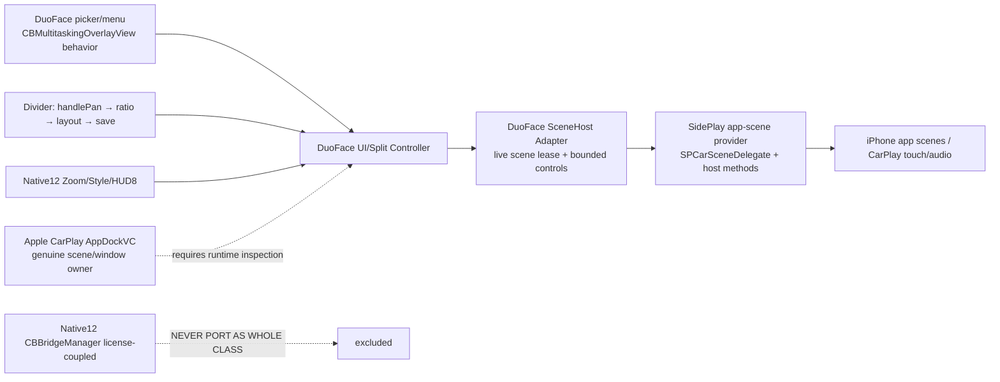

# Native12 → DuoFace + SidePlay host-only: ma trận có thể chuyển / rào cản

Kiểm tra: 2026-10-19. Đây là phân loại **dựa trên mã máy / selector / source, không phải kết quả CarPlay trên xe**. Báo cáo gốc `WIRING_REPORT.md`, source hash-pinned trong `SUMMARY.json`. Mục tiêu theo yêu cầu: SidePlay 1.0.4 chỉ giữ phần host/CarBridge app lên CarPlay và cơ chế truy cập hợp lệ còn nguyên; DuoFace Native12 làm chủ toàn bộ giao diện và chức năng. **Không có bằng chứng tách riêng được một binary “CarPlay license” SidePlay**.

## A. Sơ đồ ranh giới sẽ nối

## B. Đưa được qua theo mức độ

| Phần / phương thức Native12 | Dữ liệu đã xác minh | Mức chuyển | Phải làm trước khi bật |
|---|---|---|---|
| `CBDividerView.handlePan:` IMP `0x10152c`, `setOnPanChanged:` | gesture/pan callback có trong ObjC ABI, selector `onPanChanged` xuất hiện ở các callsite | **Có thể viết module giao diện DuoFace độc lập** | Kết nối tới đúng split owner; không gọi SPDash layout song song |
| `CBBridgedSplitApp.handleDividerPan:isVertical:state:` IMP `0x103ee0` | `carPlayUsableBounds` PC `0x103f68`, `setSplitRatio:` `0x104100`, `layoutSplitViews` `0x104254`, `saveBridgeStateToDisk` `0x104330` | **Chuyển logic theo chuỗi, không thả nguyên dylib** | DuoFace phải sở hữu split controller/persistence, SidePlay chỉ cấp scene view |
| `CBBridgedSplitApp.layoutSplitViews` IMP `0x1044f8`, `focusSlot:animated:`, `persistSlotOrder` | selector/IMP/callsites đã giải tĩnh | **Có thể thiết kế lại theo Native12** | Normal/Zoom, app frame, swap, 2-slot/4-slot và đồng bộ state phải thống nhất |
| `CBMultitaskingOverlayView.showAppPickerForSlot:parentView:` IMP `0xaa800`, `showLayoutChooserInParentView:` `0xaacf0` | `CBWindow.showAppPickerForSlot:` IMP `0xb25e4` gọi selector tại `0xb2674` | **UI có thể chuyển; hành động launch còn chặn** | Chứng minh đúng kiểu tham số/callsite `SPPane.loadApp:`; cắt SidePlay picker chỉ sau thử app thật |
| Các thành phần `CBAppManager`, `CBSplitViewController`, `CBAppPickerViewController` (DuoFaceUI) | các class riêng nằm trong 522 methods của app iPhone | **Có thể thiết kế giao diện/settings mới** | Tách giao diện ứng dụng khỏi `XXAppDelegate`/license sync; không bê nguyên app binary |
| `DFHostGeometry`, `DFFullscreenTransport`, `DFPickerZoomMenu`, `DFDashboardChrome` | có file .xm/.mm source dự án; nhị phân Fullscreen có 61 ObjC methods | **Có thể thích nghi source-owned policy** | Thay CBWindow/CBBridgeManager owner reference bằng adapter thật; giải callback/IPC và test rollback |
| `DuoFaceSpeedHUD` (44 methods), `DuoFaceSpeedOwner` (1 method) | SpringBoard filter, chuỗi 4 nguồn tốc độ | **Có thể chuyển UI/owner HUD độc lập** | 422+67 stub call không giải selector; xác minh nguồn dữ liệu/scene/đóng app; không sao chép SidePlay HUD |
| `CBWindow.carPlayScreenBounds/contentInsets/carPlayUsableBounds` IMP `0xb0ef4` | geometry selector và callsites trong createWindows/resizeWindows | **Chuyển chính sách tính toán, KHÔNG gọi class CBWindow khi chỉ có SidePlay** | đo được scene/window owner và Dock thật; không hardcode 64pt thay cho AppDock |

## C. Vướng mắc phải giải trước khi nối

| Rào cản | Bằng chứng | Trạng thái và cách xử lý |
|---|---|---|
| **Giấy phép lẫn vào host Native12** | `CBBridgeManager.init` IMP `0x12192c` → `checkAndSyncLicenseIfNeeded`; `requestStateChange:` IMP `0x13b158` → license checks PC `0x13b1fc/0x13b21c`, `loadNewAppFromCurrentRequest:` PC `0x13b414`; class có `licenseWatchdogTimerFired:`, `scheduleMandatoryDisconnectWatchdog`, `enforceMandatoryDisconnectKill`. `XXAppDelegate` cũng gọi sync | **KHÔNG chuyển nguyên CBBridgeManager/XXAppDelegate binary, không can thiệp license**. Dùng SidePlay làm provider host hợp lệ, chỉ viết DuoFace UI độc lập. Việc tách package license SidePlay thành một phần riêng **chưa chứng minh khả thi**. |
| **Kiểu tham số SidePlay mở app chưa rõ** | `SPPane.loadApp:` encoding `v24@0:8@16` chỉ cho biết argument `id` | **NO-GO M2 launch** cho tới khi phân tích callsite/kiểu thật; M1 read-only bridge build đã PASS, không gọi load/unload. |
| **Dock hệ thống không do DuoFace tự vẽ** | `CBDashboardShared.appDockVC` IMP `0x1217d8`; `CBBridgeManagerDashboard.setAppDockActiveBundleID:` IMP `0x2a4934`, `appDockVC` callsite `0x2a4968`, `_refreshAppDock` `0x2a4a08/0x2a4a18`; `getDockDimension` đọc `view.frame` | **NO-GO tuyên bố Dock đã sửa** tới khi runtime xác minh Apple AppDock controller và CarPlay UIWindow/UIScene thuộc đúng process, z-order; `DBStatusBarWindow` hay 64pt inset không tạo được icon Dock. |
| **Cross-process/optimized ObjC dispatch chưa rõ** | Tổng 1.087 optimized `__objc_stubs` unresolved: Fullscreen 598, SpeedHUD 422, SpeedOwner 67; receiver ObjC runtime động | Phải đối chiếu function PC→selector, IPC send/receive, ownership và callback; chưa được coi screenshot hay build CI là thành công. |
| **SidePlay UI và host tích hợp cùng lớp** | `SPDash` vừa có `panes`, vừa `layout/setRatio/showPickerForPane/layoutChooser`; `SPPane` có view/appVC nhưng cũng có menu/grabber/bar | Adapter M1 chỉ read-only trạng thái app/CGRect. Không thể gỡ thẳng `com.sideplay` hay `SPDash` khi chưa thay host. Thay owner mỗi chức năng rồi test trước khi bỏ UI/hook gốc. |

## D. Quy tắc GO/NO-GO trước khi nối

- **M1 đã PASS build**: `DFSPSceneHostBridge` chỉ nhận live `SPDash.panes` và `SPPane.view/appViewController`; GitHub Actions run 39187072607 macos-15 Theos PASS. **Chưa test hai scene thật trên xe.**
- **M2 App picker:** xem callsite `SPPane.loadApp:` → xác định object type; dựng Native12 picker/menu do DuoFace sở hữu, chọn app mở thực tế rồi mới bỏ SidePlay picker/chooser.
- **M3 Divider/ratio:** nối `handlePan` → `setSplitRatio` → `layoutSplitViews` → persistence; đồng thời dừng SidePlay làm owner layout; test swap, focus, reconnect.
- **M4 Dock:** xác minh AppDockVC và window owner trên xe **trước khi** công bố đã port; nối metrics/usableBounds/Zoom rollback thống nhất.
- **M5–M6:** HUD, Style, iPhone prefs; cuối cùng dọn phần SidePlay UI đã thay, vẫn giữ host/provider và license hợp lệ nếu là dependency cần thiết.

**Giới hạn bằng chứng:** các selector/callsites có thể là lời gọi dynamic receiver; danh sách chính xác không chứng minh callback được thực thi trên iOS của người dùng. Phải kiểm `caller → selector → receiver → process/scene → teardown` trước khi nối thật.
